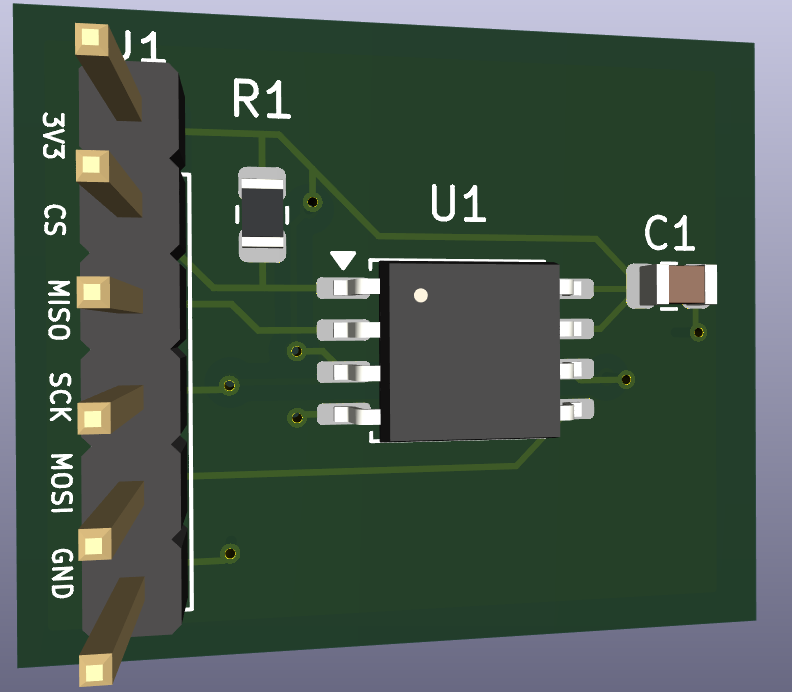
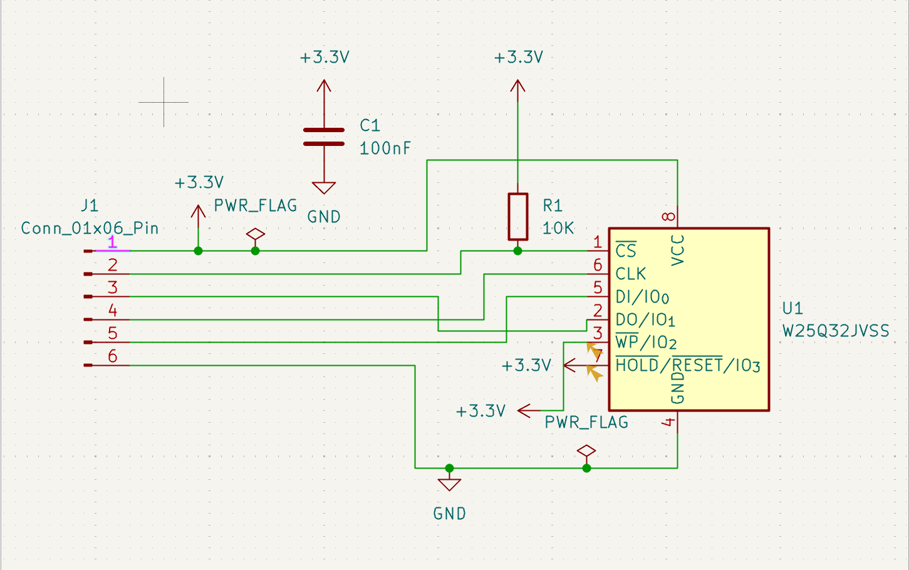
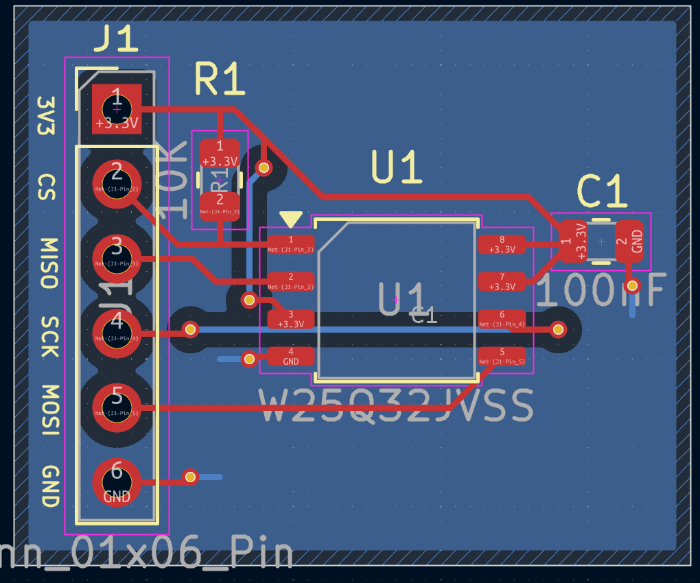

# SPI Flash Memory PCB Design | KiCad

### 2-Layer PCB Design — W25Q32JV SPI Flash Memory

A personal electronics project focused on electronic schematic design, PCB layout, signal routing, power distribution, and design verification using **KiCad**.

The objective was to design a 2-layer SPI Flash memory breakout board for interfacing with an external STM32 microcontroller.

This project was developed to strengthen my practical skills in PCB design and routing.

---

## 1. PCB 3D Visualization

The 3D visualization shows the component placement, SPI connector, PCB dimensions, and silkscreen labeling.

---

## 2. Electronic Schematic

The electronic schematic was designed around the **W25Q32JVSS SPI Flash memory**.

### Main Components

| Reference | Component | Function |
|-----------|-----------|----------|
| U1 | W25Q32JVSS | 32 Mbit SPI Flash memory |
| R1 | 10 kΩ | CS pull-up resistor |
| C1 | 100 nF | Power supply decoupling |
| J1 | 6-pin connector | SPI interface with STM32 |

### Schematic Design

- 3.3 V power supply
- SPI communication: CS, SCK, MOSI, MISO
- 100 nF decoupling capacitor between VCC and GND
- 10 kΩ pull-up resistor on CS
- WP and HOLD pins connected to 3.3 V
- External STM32 connection through a 6-pin connector

The schematic was checked using KiCad's Electrical Rules Checker (ERC).

---

## 3. PCB Layout & Routing

The PCB was designed using a **2-layer architecture**.

### Layer Configuration

| Layer | Function |
|-------|----------|
| F.Cu | SPI signals and 3.3 V power routing |
| B.Cu | Ground copper plane and necessary signal routing |
| F.Silkscreen | Component references and connector labels |
| Edge.Cuts | Physical PCB outline |

### PCB Routing Decisions

- Placed the SPI Flash memory close to the connector.
- Positioned the decoupling capacitor near the VCC pin.
- Placed the CS pull-up resistor close to the memory.
- Routed SPI signals while respecting electrical clearances.
- Used vias where necessary to avoid trace crossings.
- Implemented a ground copper plane on B.Cu.
- Connected ground pads through vias.
- Optimized component placement to reduce unnecessary trace lengths.

---

## 4. SPI Interface

The PCB is designed to communicate with an external STM32 microcontroller using SPI.

### Connector Pinout

| J1 Pin | Signal | Description |
|--------|--------|-------------|
| 1 | 3V3 | 3.3 V power supply |
| 2 | CS | Chip Select |
| 3 | MISO | Master In Slave Out |
| 4 | SCK | SPI Clock |
| 5 | MOSI | Master Out Slave In |
| 6 | GND | Ground |

The external STM32 board must provide a regulated 3.3 V supply and compatible SPI logic levels.

---

## 5. PCB Design Considerations

### Component Placement

Component placement was organized to simplify routing and reduce connection lengths.

Special attention was given to the decoupling capacitor, which was placed close to the memory power supply pin.

### Power Distribution

The PCB uses a 3.3 V power supply.

The power routing was designed with consideration for trace width, connection lengths, and local decoupling.

### Ground Plane

A ground copper zone was implemented on the bottom copper layer.

Ground vias were used to connect component ground pads to the ground plane.

### Signal Routing

SPI signal traces were routed while avoiding electrical crossings on the same copper layer.

The placement and routing were progressively optimized to reduce unnecessary detours.

### EMC Considerations

Basic electromagnetic compatibility principles were considered during the design:

- Reducing unnecessary routing loops
- Keeping the decoupling connections short
- Considering signal return paths
- Preserving ground plane continuity where possible

Formal EMC testing has not been performed.

---

## 6. Design Verification

The following design steps were completed:

- [x] Electronic schematic design
- [x] Component selection
- [x] Footprint assignment
- [x] Electrical Rules Check (ERC)
- [x] PCB component placement
- [x] Signal and power routing
- [x] Ground plane implementation
- [x] Design Rules Check (DRC)
- [x] Silkscreen labeling
- [x] 3D PCB visualization
- [ ] Physical PCB manufacturing
- [ ] Hardware testing
- [ ] SPI communication validation with STM32

### Validation Status

The schematic and PCB were checked using KiCad ERC and DRC tools.

**The PCB has not yet been manufactured or physically tested.**

Therefore, electrical operation and SPI communication have not yet been experimentally validated.

---

## 7. Project Files

| File | Description |
|------|-------------|
| `SPI_FLASH_STM32.kicad_pro` | KiCad project configuration |
| `SPI_FLASH_STM32.kicad_sch` | Electronic schematic |
| `SPI_FLASH_STM32.kicad_pcb` | PCB layout and routing |
| `images/schematic.png` | Electronic schematic screenshot |
| `images/pcb-layout.png` | PCB routing screenshot |
| `images/pcb-3d.png` | 3D PCB visualization |

The KiCad source files are included to allow the schematic and PCB design to be inspected and modified.

---

## 8. Tools & Technical Skills

### Software

- KiCad Schematic Editor
- KiCad PCB Editor
- KiCad 3D Viewer
- KiCad ERC / DRC

### Skills Practiced

- Electronic schematic design
- Component footprint selection
- PCB component placement
- Two-layer PCB routing
- SPI interface design
- Power distribution
- Decoupling capacitor placement
- Ground plane implementation
- Via placement
- Design rule verification
- PCB documentation

---

## 9. Future Improvements

- Further optimization of PCB dimensions
- Additional review of signal routing and ground return paths
- Manufacturing file generation and verification
- PCB prototype manufacturing
- Component assembly and soldering
- Hardware testing using an STM32 microcontroller
- SPI JEDEC ID reading
- Flash memory read/write functional testing

---

## 10. Author

**Amine Haj Salah**

Electronics & Embedded Systems

[LinkedIn](https://www.linkedin.com/in/amine-haj-salah/) |
[GitHub](https://github.com/aminehajsaleh) |
[Portfolio](https://aminehajsaleh.github.io/PORTFOLIO/)
